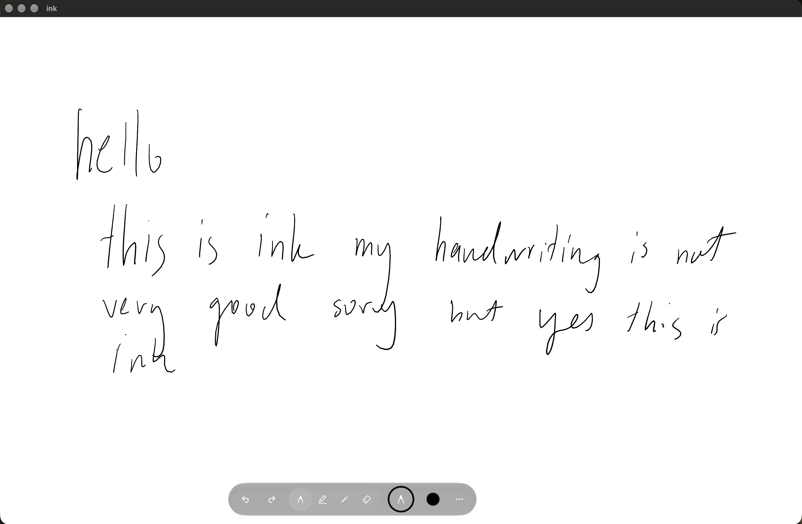

# ink

A freeform document app for macOS designed around drawing tablets

# What ink is
ink is an infinite canvas that lets you draw using either your trackpad or a connected drawing tablet. It detects for pressure (accounted your tablet supports that), has a scribble gesture that lets you easily disintegrate strokes and a tool palette to swich between different tools and colours.
- To use a stylus you may need to confirm that your drawing tablet's drivers are up-to-date
- The tool palette has a pen tool, highlighter tool, eraser tool (deletes by touching strokes), and a pencil tool; there are also undo/redo buttons

# How to Install ink
Currently, ink is only supported on macOS Tahoe and later (26+) due to the use of liquid glass elements.

> In future versions this minimum requirement operating system will be reduced.

To install it:
- Check out the [latest release](https://github.com/dylankaru/ink/releases/latest) and download the DMG installer. Then just run and follow the install instructions.

> Note: since ray was downloaded over the internet, macOS may block you from running it. This is because ink isn't notarised, so you'll have to right-click the app and press `Open` to bypass it, and if that doesn't work you'll have to go to `System Settings`, then `Privacy and Security`, scroll down to security and press `Open Anyway`
